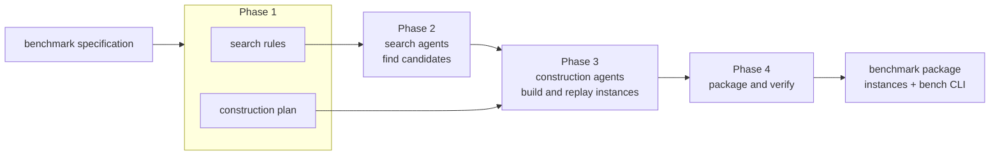

# BenchMeUp

BenchMeUp builds an executable benchmark from a natural-language description of a task. A
researcher writes a short **benchmark specification**: what the task is, what one instance
contains, where instances may come from, and when a technique's answer counts as correct.
LLM agents then search public sources for candidates, construct a runnable instance from each
candidate, and the framework replays every instance in a fresh container before packaging all
of them behind one command-line interface.



| phase | what happens | output |
|---|---|---|
| 1. Search rules and construction plan | A model turns the specification into search rules, which a second model reviews, and into a construction plan, which is also reviewed. | `canonical.json`, `contract.json` |
| 2. Finding candidates | Search agents explore external sources in parallel and share summaries of their directions; each verifies its candidates with its own existence-check script. The framework deduplicates the pool. | `stock/<task>/candidates.jsonl` |
| 3. Turning candidates into instances | Construction agents follow the plan stage by stage; the framework replays their scripts in fresh containers after each stage. Agents share lessons learned. | `instances/<id>/` |
| 4. Packaging | The framework writes a manifest and a common command-line interface, and re-runs every packaged instance in a fresh container. | `benchmarks/<set>/<task>/` |

## Tasks

The repository contains four tasks, each with its specification, the generated search rules
and construction plan, the candidates the search found, and the packaged benchmark.

| task | key | an instance is | correct when | specification | benchmark | instances |
|---|---|---|---|---|---|---|
| program repair | `d4j` | a bug-fixing commit with a bug-exposing test | the test fails before the fix and passes after the submitted patch, with no new failures | [spec](specs/d4j/spec.yaml) | [benchmark](benchmarks/default/d4j/README.md) | 51 |
| issue reproduction | `swt` | an issue-closing pull request that adds or changes a test | the submitted test fails before the pull request and passes after it | [spec](specs/swt/spec.yaml) | [benchmark](benchmarks/default/swt/README.md) | 49 |
| compiler autotuning | `boca` | a runnable C program at a repository commit | the program built with the submitted flags produces the same output as the default build | [spec](specs/boca/spec.yaml) | [benchmark](benchmarks/default/boca/README.md) | 50 |
| fixing static-analysis warnings | `sonarqube` | a SonarQube warning at a location, with a developer's fix | the warning disappears without a new finding | [spec](specs/sonarqube/spec.yaml) | [benchmark](benchmarks/default/sonarqube/README.md) | 47 |

## Quick start

### Look at an instance

This needs Python 3 and Docker, and no model.

```
examples/run_example.sh d4j       # or boca, swt, sonarqube
```

or by hand:

```
cd benchmarks/default/d4j
./bench list
./bench prepare <id>              # build the image from the Dockerfile, run setup.sh
./bench judge <id>                # build every version, run the checks, apply the oracle
./bench submit <id> /bench/fix.patch
```

### Run the pipeline

```
python3 -m venv .venv && . .venv/bin/activate
pip install -e .
cp .env.example .env              # fill in what your model route needs
bench --help

# Phase 1: search rules and construction plan
bench formalize specs/boca/spec.yaml --model <model> --out runs/boca/canonical.json
bench search-agent specs/boca/spec.yaml --canonical runs/boca/canonical.json --out agents/boca_search_new --model <model> --target 10
bench worker specs/boca/spec.yaml --canonical runs/boca/canonical.json --out agents/boca_worker_new --model <model>

# Phase 2: search, then freeze the candidate pool
scripts/search_epoch.sh boca agents/boca_search_new 1 2 10 30
bench stock-freeze runs/search/boca/epoch_1/attempt_* --out stock/boca_new --agent agents/boca_search_new

# Phase 3: construction
python scripts/construct_arms.py stock/boca_new/candidates.jsonl agents/boca_worker_new \
    runs/construct/boca/epoch_1 arms.json --target 4

# Phase 4: packaging and the final check
python scripts/package.py --task boca --runs runs/construct/boca/epoch_1 --out benchmarks/mine/boca \
    --contract agents/boca_worker_new/contract.json
python scripts/certify_packaged.py benchmarks/mine/boca --contract agents/boca_worker_new/contract.json --fresh
```

Search and construction call a model and cost money; set the budgets in the commands. See
[docs/pipeline.md](docs/pipeline.md) for every command and option, and
[docs/configuration.md](docs/configuration.md) for model routes, tokens and environment variables.

## Requirements

- Linux, Python 3.11 or later, Docker (reachable by the current user), git.
- To run the pipeline: a model route and a GitHub token for the search agents.
- To judge a packaged instance: Python 3 and the Docker CLI.

## Repository layout

| path | content |
|---|---|
| `benchcompiler/` | the framework: formalization, agent generation, search hand-over, lessons, packaging, the `bench` command |
| `agentcore/` | the agent runtime: loop, Docker environments, tools, replay harness, model backends |
| `specs/<task>/` | the benchmark specification (`spec.yaml`) and the generated search rules (`canonical.json`) |
| `agents/` | the generated search and construction agents of each task, and the shared prompt templates (`_shared/`) |
| `stock/<task>/` | the candidates the search agents found |
| `benchmarks/default/<task>/` | the packaged benchmarks |
| `scripts/` | launchers for search, construction, packaging and certification |
| `examples/` | a script that runs one packaged instance per task |
| `docs/` | pipeline, configuration, operations |
| `tests/`, `benchcompiler/tests/` | the test suite |

`bench-ui` is an optional read-only web view of tasks, runs and benchmarks ([docs/ui.md](docs/ui.md)).

## Tests

```
pytest -m "not docker and not e2e and not network"     # the offline tier, a few minutes
pytest                                                   # everything; needs Docker and network
```

## License

MIT, see [LICENSE](LICENSE).
